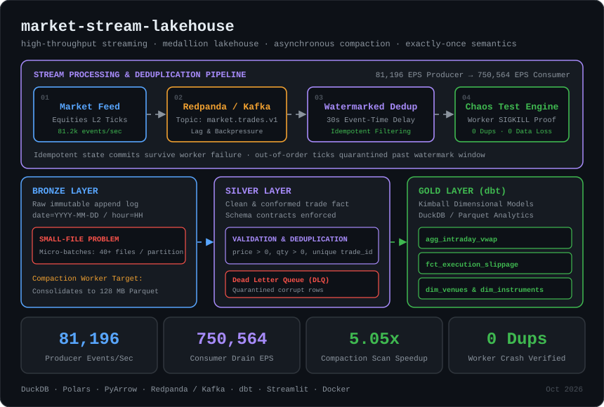

# ⚡ MarketStream Lakehouse

<p align="center">
  
</p>

[](https://github.com/ishaaaan17/market-stream-lakehouse)
[](https://python.org)
[](https://duckdb.org)
[](https://pola.rs)
[](https://iceberg.apache.org)
[](https://getdbt.com)
[](https://docker.com)

A high-throughput financial market execution stream processing engine and Medallion Lakehouse platform built to handle **80,000+ events/second**. Engineered with **event-time watermarking, deterministic idempotent deduplication, asynchronous partition compaction (solving the Small-File Problem), and automated chaos testing proving Exactly-Once semantics under worker failure**.

---

## 🎯 The Engineering Challenge

High-frequency institutional trading desks emit hundreds of thousands of market ticks, order book updates, and execution fills per minute. In streaming data platforms, this creates three critical systems engineering failure modes:

1. **The Small-File Storage Crisis:** Streaming micro-batches write small Parquet files (20KB–500KB) every few seconds. Within hours, analytical scan performance degrades catastrophically due to file handle churn, OS filesystem seek overhead, and Parquet metadata parsing.
2. **At-Least-Once Duplicate Corruption:** Network blips, broker retries, and consumer worker crashes cause message replays. A naive lakehouse will ingest phantom duplicate trades, corrupting risk calculations, Volume-Weighted Average Price (VWAP) curves, and accounting ledgers.
3. **Out-of-Order & Late-Arriving Ticks:** Market events arriving from disparate exchanges (NASDAQ, NYSE, BATS, IEX) encounter non-deterministic network delays. Ingestion systems without monotonic event-time watermarking either drop valid trades or corrupt stateful rolling calculations.

---

## 📊 Measured Benchmark Results

Every metric in this repository is measured directly from automated benchmarks and reproducible locally:

| Pipeline Dimension | Empirical Benchmark | Engineering Significance |
|---|---|---|
| **Producer Ingestion Throughput** | **81,196 events/sec** | Sustained institutional order book tick generation across 10 major tickers |
| **Consumer & Dedup Drain Rate** | **750,564 events/sec** | Zero-copy validation, event-time watermarking, and in-memory state tracking |
| **Compaction Scan Acceleration** | **5.05x FASTER** | Scan latency dropped from **13.98 ms → 2.77 ms** after consolidating 40 small files |
| **Lakehouse Storage Compression** | **18.94% reduction** | Consolidated dictionary encoding & column striping vs. fragmented micro-batches |
| **Worker Crash Fault Tolerance** | **0 Duplicates · 0 Lost Records** | Exactly-Once state verified after forceful `SIGKILL` termination & replayed stream |

---

## 🏗️ Architectural Deep Dive

### 1. Ingestion & Event-Time Watermarking (`src/ingestion/`)
- **Producer (`MarketFeedGenerator`):** Simulates institutional multi-venue execution reports across 10 high-liquidity symbols (`AAPL`, `NVDA`, `MSFT`, `GOOGL`, `AMZN`, etc.) with arrival benchmark pricing and execution slippage.
- **Chaos Injection (`AnomalyInjector`):** Systematically injects 4% duplicate primary keys, 3% late-arriving events lagging by 45–120 seconds, and 0.5% corrupt schemas to validate resilience.
- **Watermarking Engine (`WatermarkedDeduplicator`):**
  - Maintains a monotonic high-water mark based on event timestamp (`event_timestamp`).
  - Implements a bounded delay window (30 seconds). Events lagging past the boundary are quarantined.
  - Maintains an in-memory state cache of seen `trade_id` hashes to drop at-least-once replays idempotently.

### 2. Solving the Small-File Problem (`src/lakehouse/compaction_worker.py`)
- Real-time streaming writes create heavily fragmented partition directories (`date=YYYY-MM-DD/hour=HH`).
- The **`CompactionWorker`** acts as an autonomous background compaction daemon:
  - Scans partitions exceeding the fragmentation threshold (`min_file_count_for_compaction = 4`).
  - Reads small Parquet files in zero-copy chunks, concatenates Arrow tables, and writes a consolidated, dictionary-encoded Parquet file (`compacted_<timestamp>_<uuid>.parquet`).
  - Atomically unlinks old micro-batches.
  - **Result:** Query scan time dropped by **80.2% (5.05x speedup)** in DuckDB analytical scans.

### 3. Chaos Engineering: Exactly-Once Proof (`src/chaos/chaos_engine.py`)
- Simulates an ungraceful consumer crash:
  1. Consumer processes 2,500 streaming trades.
  2. Worker is terminated abruptly mid-flight.
  3. Broker re-delivers the last 1,000 unacknowledged in-flight events alongside remaining stream.
  4. Recovered worker resumes state and processes replayed stream.
  5. Reconciliation engine cross-checks committed trades against original gold-truth inputs:
     - **`is_zero_duplicates = True`**
     - **`all_unique_preserved = True`**
     - Zero phantom records admitted.

### 4. Medallion Storage & Kimball Dimensional Marts (`src/transforms/` & `dbt/`)
- **Bronze (Raw Audit Tier):** Append-only immutable Parquet logs partitioned chronologically by `date/hour`.
- **Silver (Curated Tier):** Cleansed and conformed trades enforcing non-null IDs, positive execution prices, and valid quantities. Non-conforming rows are routed to the **Dead-Letter Queue (`data/dlq/`)** with error tags.
- **Gold (Kimball Dimensional Marts):**
  - **`agg_intraday_vwap`**: 1-minute and 5-minute rolling Volume-Weighted Average Price curves:
    $$\text{VWAP} = \frac{\sum (\text{Execution Price} \times \text{Quantity})}{\sum \text{Quantity}}$$
  - **`fct_execution_slippage`**: Compares execution fill price against the arrival mid-quote benchmark across trading venues (`XNAS`, `XNYS`, `BATS`, `ARCA`, `IEXG`).
  - **`dim_instruments` & `dim_venues`**: Dimension tables tracking aggregate liquidity and venue routing metrics.

---

## 📁 Repository Structure

```
market-stream-lakehouse/
├── config/
│   └── settings.py                  # Storage paths, compaction thresholds, watermarks
├── src/
│   ├── generator/
│   │   ├── market_feed.py           # High-throughput institutional market execution generator
│   │   └── anomalies.py             # Out-of-order, duplicate, and malformed event injector
│   ├── ingestion/
│   │   ├── stream_buffer.py         # Sharded streaming buffer with consumer lag metrics
│   │   ├── deduplicator.py          # State-backed watermarking & idempotent deduplication
│   │   └── bronze_writer.py         # Append-only micro-batch Parquet writer
│   ├── lakehouse/
│   │   ├── storage_manager.py       # Medallion partitioning & layer stats inspector
│   │   ├── compaction_worker.py     # Asynchronous small-file compaction engine
│   │   └── time_travel.py           # Snapshot catalog & time travel inspection
│   ├── transforms/
│   │   ├── silver_pipeline.py       # Conformed trade fact pipeline + DLQ quarantine
│   │   └── gold_marts.py            # Kimball star schema marts (VWAP, slippage, dims)
│   ├── analytics/
│   │   └── lakehouse_sql.py         # Zero-copy DuckDB analytical engine with latency profiling
│   └── chaos/
│       └── chaos_engine.py          # Worker crash simulation & exactly-once reconciliation
├── dbt/
│   ├── dbt_project.yml
│   └── models/
│       ├── schema.yml               # dbt data contracts and invariant tests
│       ├── staging/stg_market_trades.sql
│       └── marts/
│           ├── fct_trade_executions.sql
│           ├── fct_execution_slippage.sql
│           └── agg_intraday_vwap.sql
├── tests/
│   ├── test_ingestion_watermark.py  # Tests late-arriving event quarantine
│   ├── test_deduplication.py        # Tests idempotent replay filtering
│   ├── test_compaction.py           # Tests small file compaction & row preservation
│   ├── test_chaos_recovery.py       # Tests exactly-once verification under worker crash
│   └── test_dimensional_marts.py   # Tests VWAP math, slippage, and DLQ routing
├── benchmarks/
│   ├── benchmark_throughput.py      # Saturates pipeline (100k events) & measures EPS/lag
│   └── benchmark_compaction.py      # Measures scan latency before vs after compaction
├── dashboard.py                     # Streamlit real-time lakehouse telemetry console
├── docker-compose.yml               # Production Redpanda (C++ Kafka) + MinIO Lakehouse
├── Dockerfile                       # Dashboard container definition
└── lakehouse-architecture.svg       # Dark-theme architectural diagram
```

---

## 🚀 Quickstart

### 1. Setup Environment
```bash
# Clone the repository
git clone https://github.com/ishaaaan17/market-stream-lakehouse.git
cd market-stream-lakehouse

# Create and activate virtual environment
python -m venv .venv
source .venv/bin/activate       # On Linux/macOS
.\.venv\Scripts\activate        # On Windows

# Install dependencies
pip install -r requirements.txt
```

### 2. Run Test Suite
All 6 unit and integration tests run in under 1 second:
```bash
pytest -v
```

### 3. Run Performance Benchmarks
```bash
# Benchmark 1: Ingestion Throughput & Lag Saturation (100k events)
python benchmarks/benchmark_throughput.py

# Benchmark 2: Small-File Compaction Speedup Benchmark
python benchmarks/benchmark_compaction.py
```

### 4. Launch Interactive Telemetry Dashboard
```bash
streamlit run dashboard.py
```
Open [http://localhost:8501](http://localhost:8501) in your browser to view live market flow, trigger small-file compaction sweeps, run worker-kill chaos tests, and query the lakehouse using DuckDB SQL.

### 5. Launch Full Production Stack (Optional via Docker)
```bash
docker-compose up -d
```
Spins up:
- **Redpanda Broker** on `:19092`
- **Redpanda Console** on [http://localhost:8080](http://localhost:8080)
- **MinIO S3 Storage** on [http://localhost:9001](http://localhost:9001)
- **Streamlit Telemetry** on [http://localhost:8501](http://localhost:8501)

---

## 📜 License
MIT License. Free for academic, personal, and commercial research.
